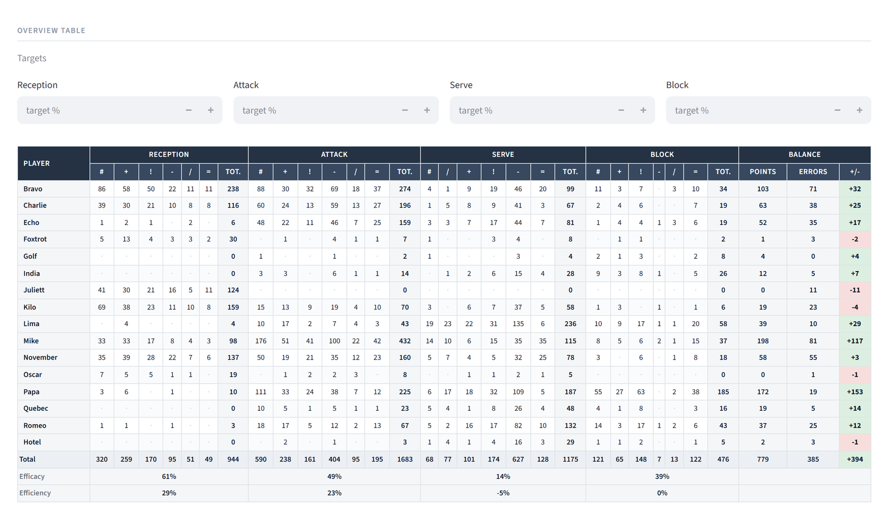
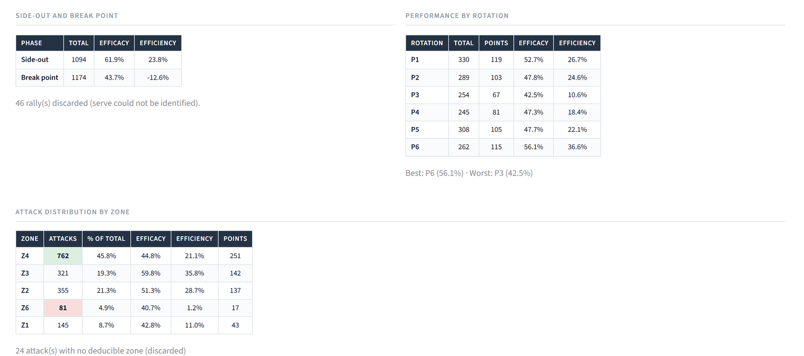
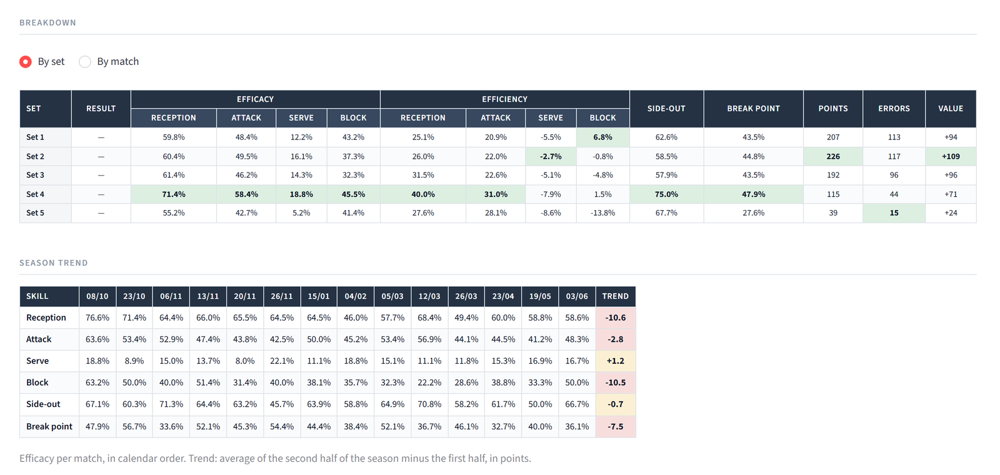
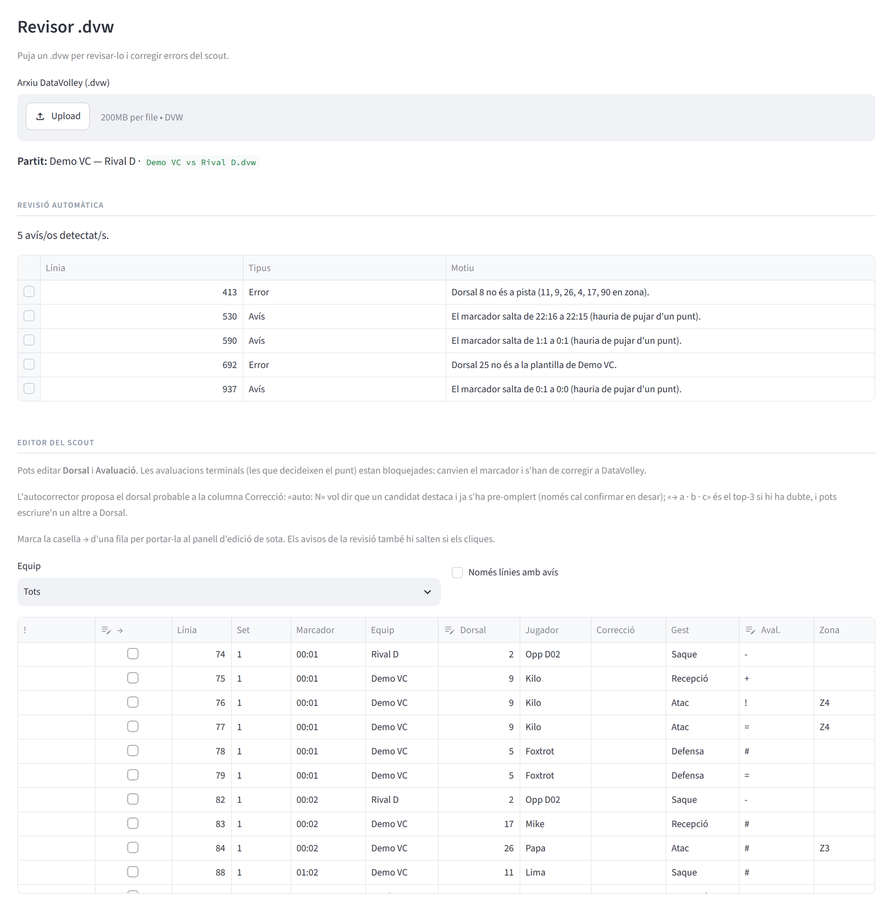

# Volleyball Analytics


**Two Streamlit tools that turn DataVolley scouting files into reports a
volleyball team can use, and catch scouting errors before they reach the
numbers.** I built them for the teams I coach and scout, and I use them after
every match.

- **Reports** (`app_dvw.py`): match, player and season analysis from `.dvw`
  files, in English, Catalan or German, with PDF export for the players.
- **Review tool** (`revisor_dvw.py`): a linter and editor for the scout itself.
  It flags impossible jersey numbers and score jumps, suggests corrections and
  saves a corrected copy without losing a byte of the original.

The demo data is **one real season: 14 matches and 14,908 rows of
play-by-play** of an amateur men's team, anonymized (see [Privacy](#privacy)).

---

## Reports

Load one match or a whole season. The app finds the team that plays in every
file and analyses it overall, per player, or against its opponents.



- **Overview table**: every evaluation mark per player and skill, plus
  efficacy, efficiency and a *points − errors* balance. Targets can be set per
  skill, and cells turn green, amber or red against them.
- **Side-out and break point**: counted per **rally**, not per attack. A long
  rally with three attacks counts once.
- **Performance by rotation** (P1 to P6).
- **Attack distribution by zone**, deduced from the rotation, because the
  scout doesn't record zones (see below).



- **Team comparison**: the team against each opponent, or against all of them
  combined.
- **Breakdown** by set or by match, with the result.
- **Season trend**: one column per match in calendar order, and a trend
  (average of the second half of the season minus the first half) so that one
  bad match doesn't decide it.
- **PDF export** of whatever is on screen, to send to each player.



### Definitions

DataVolley grades every action from `#` (best) to `=` (error), with `+`, `!`,
`-` and `/` in between.

| Metric | Formula |
|---|---|
| Efficacy | (`#` + `+`) / total |
| Efficiency | (`#` − `=`) / total, can be negative |
| Value | points − errors. Points: `#` in attack, serve and block. Errors: `=` in attack, serve and reception, and `/` in block. |
| Side-out / break point | rallies won / rallies played, when the opponent serves / when we serve |

## Review tool



Scouting live means mistakes: a wrong jersey number, a point given to the wrong
team and then undone. Those mistakes end up in the statistics without anybody
noticing. The review tool reads a `.dvw` and:

- **Lints it.** It flags jersey numbers that aren't on court or on the roster,
  and the scoreboard jumping by anything other than one point. On the 14
  matches it finds exactly the 7 known score corrections, with no false
  positives.
- **Suggests the likely jersey number.** For serves, where the rotation says
  who must be serving, the fix is deterministic and applied automatically.
- **Edits the scout.** Insert, edit or delete actions. Marks that decide a
  point are locked, because changing them would change the score.
- **Never overwrites.** It saves a new `_rev.dvw` copy. Opening and saving
  without changes gives back the original byte for byte, which is tested on all
  14 matches.

Its interface is in Catalan, the language I scout in.

## What the file format doesn't tell you

The parser (`openvolley-pydatavolley`) gives you a tidy table, but several
columns look useful and aren't. Before building any metric, I checked each one
against the data. All the figures below come from the 14 matches in this repo:

| Column | Looks like | Actually |
|---|---|---|
| `rally_number` | Rally counter | Always 1 |
| `point_won_by` | Winner of the rally | Constant within each file |
| `serving_team` | Who serves | Right in 1,159 of 2,268 rallies (51%) |
| `attack_phase` | Side-out vs. transition attack | Only 28 of the team's 1,688 attacks are marked as off reception, although it received 1,094 times |
| Counting `Point` rows | Set score | Matches the official set score in 46 of 52 sets |
| Score stored on each action | Running score | Matches the official set score in **52 of 52** sets |
| `start_zone` / `end_zone` | Attack zone | Empty: zones aren't scouted |

What the app does instead:

- **Rallies**: every `Point` row closes a rally, and its team is the winner.
  The server is the team on that rally's `Serve` row. Rallies with no
  identifiable serve are discarded and reported (46 of 2,314).
- **Set scores** come from the file's `[3SET]` section, never from counting
  plays. The 6 sets where counting fails are exactly the 6 sets with a scout
  correction (a point given and taken back), and the review tool's linter
  flags each one.
- **Attack zone** is deduced. The player's court position comes from crossing
  the jersey number with the lineup stored on each action. The role comes from
  the position relative to the setter (a 5-1 system). The zone follows from
  role and front/back row, with one exception: in rotation 1 on side-out there
  is no time to switch, so the opposite attacks from zone 4. This gives a zone
  for 1,664 of the team's 1,688 attacks. It needs no roster information, so it
  works for the opponent too.
- **Match order** comes from the date in `[3MATCH]`, not from the file name.
  A test checks that the two orders differ, so the app can't quietly go back to
  sorting alphabetically.

## Privacy

The matches are real, so they were anonymized before publishing with
[`tools/anonimitza_dvw.py`](tools/anonimitza_dvw.py):

- Players get pseudonyms that stay the same all season, so the season totals
  don't change. Teams become "Demo VC" and "Rival A–K".
- Coaches, referees, venue, city, league and the software licence number are
  removed.
- Every date is shifted by the same 156 weeks, including the hidden ones (an
  Excel serial date and the file's creation stamps). Order, intervals and
  weekdays are preserved.
- DataVolley stores a hex-encoded copy of every text field, so replacing the
  text alone isn't enough. The script regenerates those copies too. Before
  writing anything, it searches the output for every original value, in plain
  text and in hex, and aborts if it finds one.

I also checked the result separately. The 14,908 play-by-play rows parse
identically before and after, and none of the 337 words in the original headers
appears in the published files. The mapping is not stored anywhere.

## Tests

`python tests/executa_tests.py` runs **163 checks** in plain Python, no test
framework. They cover:

- the lossless round trip of all 14 matches;
- the editing engine;
- Streamlit session-state pitfalls, using `streamlit.testing`;
- the scoreboard rules;
- the metric formulas;
- zone deduction and chronological order;
- that every interface text exists in all three languages.

GitHub Actions runs them on Linux and Windows on every push.

## Run it

Requires Python 3.11+.

```bash
python -m pip install -r requirements.txt
python -m streamlit run app_dvw.py       # reports
python -m streamlit run revisor_dvw.py   # review tool
python tests/executa_tests.py            # 163 checks
```

Matches are read from `Partits/<season>/<club>/<team>/`. The app browses that
tree, so two teams are never mixed by accident.

## Project structure

The code and its comments are in Catalan.

| Path | What it is |
|---|---|
| `app_dvw.py` | Reports app: parsing, metrics, HTML tables, PDF export, interface |
| `revisor_dvw.py` | Review tool: lossless `.dvw` parser/writer, linter, jersey-number suggestions, editor |
| `tools/anonimitza_dvw.py` | The anonymizer used for the demo data |
| `tests/` | One script per area, and `executa_tests.py` to run them all |
| `Partits/` | The 14 anonymized matches |
